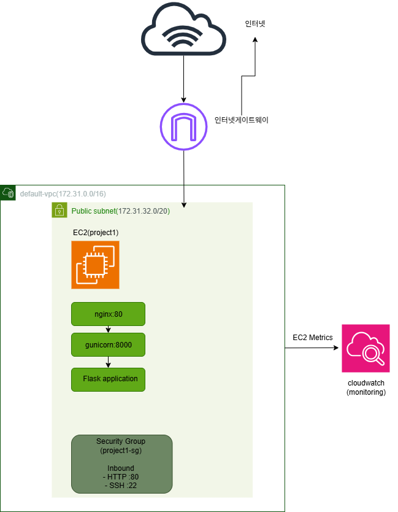
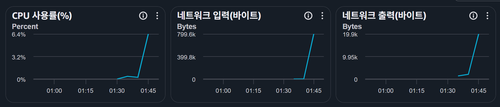

# Project1

AWS 인프라를 직접 구축하며 네트워크, 서버, 보안 설정을 실습하고  
아키텍처 의사결정과 트러블슈팅 과정을 기록하는 프로젝트입니다.

## Goal

- AWS EC2 기반 서버 구축
- Security Group을 통한 접근 제어
- Nginx Reverse Proxy 구성
- Gunicorn과 Flask를 이용한 애플리케이션 서버 구성
- CloudWatch 기본 모니터링
- 아키텍처 설계 및 개선 과정 기록

## Environment

- AWS Region: ap-northeast-2 (Seoul)
- VPC: Default VPC
- Subnet: Public Subnet
- EC2 Instance Name: `project1`
- OS: Amazon Linux 2023

## Architecture

### Implemented Architecture



현재 구현 구조:

```text
Internet
   ↓
Internet Gateway
   ↓
Default VPC
   ↓
Public Subnet
   ↓
Security Group
   ↓
EC2 project1
   ↓
Nginx :80
   ↓
Gunicorn :8000
   ↓
Flask Application
```

## Implementation

현재까지 다음 구성을 완료했습니다.

- Default VPC 사용
- Public Subnet에 EC2 `project1` 배포
- Security Group 구성
  - SSH 22: 제한된 소스만 허용
  - HTTP 80: 웹 접속 허용
- Amazon Linux 2023 사용
- Nginx를 Reverse Proxy로 구성
- Gunicorn을 `127.0.0.1:8000`에서 실행
- Flask Application 연결
- Gunicorn을 systemd 서비스로 등록
- EC2 재부팅 후 자동 실행 확인
- Gunicorn 프로세스 종료 시 `Restart=always` 설정을 통한 자동 복구 확인
- `curl`을 이용해 Gunicorn 직접 요청과 Nginx Reverse Proxy 요청을 각각 확인

## Monitoring

EC2에서 기본 제공되는 CloudWatch Metrics를 이용해 인스턴스 상태와 기본 트래픽을 확인했습니다.

확인한 주요 지표:

- CPUUtilization
- NetworkIn
- NetworkOut
- StatusCheckFailed



현재 프로젝트 규모에서는 별도의 모니터링 스택을 추가하지 않고 CloudWatch 기본 지표로 상태를 확인하도록 구성했습니다.

## Documentation

- 초기 아키텍처 설계: `docs/architecture/initial-architecture.drawio`
- 실제 구현 아키텍처: `docs/architecture/implemented-architecture.drawio`
- 트러블슈팅 기록: `docs/troubleshooting.md`
